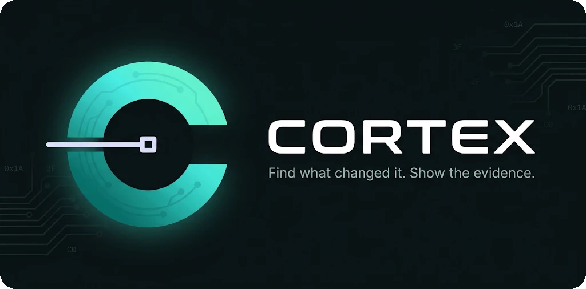
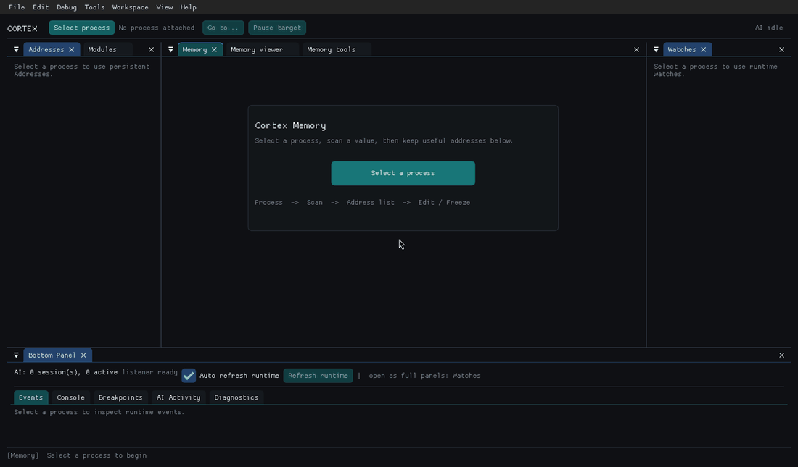
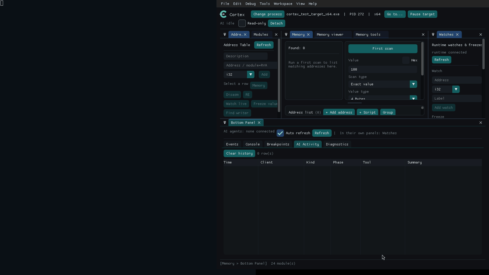
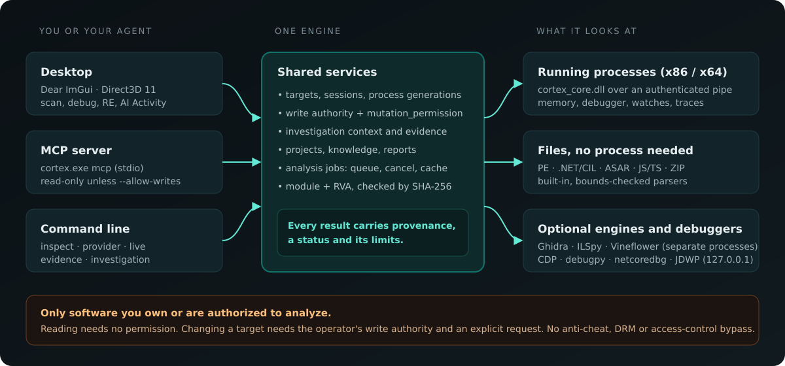
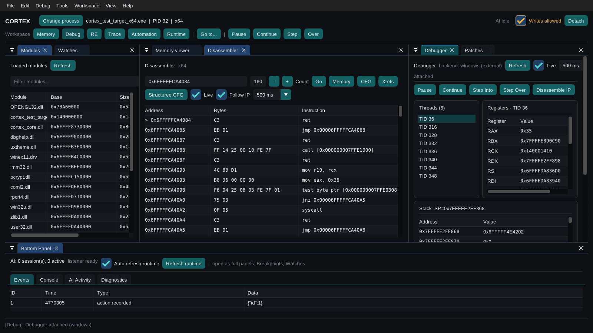
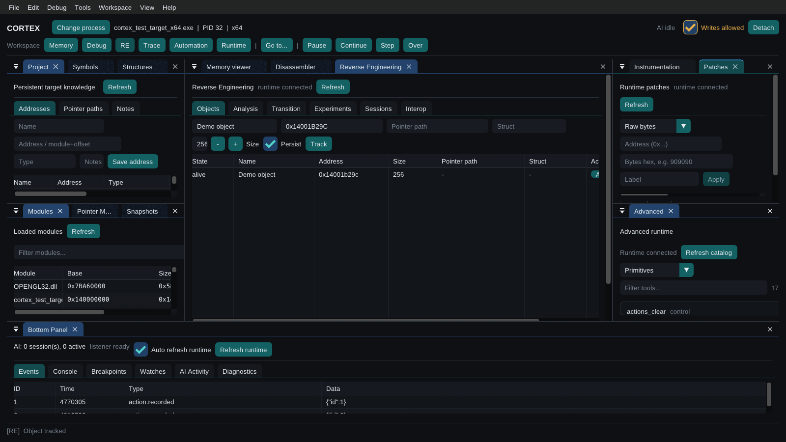

<div align="center">

<picture>
  <source media="(prefers-color-scheme: dark)" srcset="docs/images/brand/cortex-banner-dark.png">
  <source media="(prefers-color-scheme: light)" srcset="docs/images/brand/cortex-banner-light.png">
  
</picture>

**See inside any software you own.** Find the value, catch the instruction that changes it, show the evidence.

Memory scanner, debugger and reverse-engineering workspace for Windows software in one native app.
It reads files as well as live processes, can use Ghidra, ILSpy and live debuggers, and has an MCP server so an AI agent can do the same work under your control.

[](https://github.com/PdB333/cortex/actions/workflows/imgui-gui-tests.yml)
[](https://github.com/PdB333/cortex/releases)


[](LICENSE)

[Two ways to use it](#two-ways-to-use-cortex) · [Quick start](#quick-start) · [See it work](#see-it-work) · [What you can analyze](#what-you-can-analyze) · [AI & MCP](#ai--mcp) · [Safety](#safety-model) · [FAQ](#faq) · [Docs](#documentation)

<br>



<sub>Recorded from the real desktop against the repository's test target: attach, scan, narrow down, <i>find out what writes</i>, disassembler. No speed-up and no edits besides the captions.</sub>

</div>

<br>

> [!WARNING]
> Use Cortex only on software and systems you own or are authorized to inspect. It is for debugging, research, interoperability, accessibility, testing and controlled modding. Anti-cheat, DRM and access-control bypass, and interference with online services, are out of scope.

## Why Cortex

- **One tool instead of five.** Scanner, memory viewer, disassembler, debugger, patcher, tracer, RE workspace, scripting and diagnostics all work on the same target and project, with one shared address menu.
- **Read-only until you decide otherwise.** Every session starts **Read-only**. Writes, freezes, patches, breakpoints, and even loading the runtime into the target, need **Writes allowed** in the desktop or `--allow-writes` on the MCP server. An agent cannot grant itself that.
- **Files as well as processes.** Inspect a PE, a .NET assembly, an Electron `.asar` or a JavaScript bundle without running it. Optionally hand it to Ghidra, ILSpy or Vineflower and map the results back to the live process by module and RVA.
- **Built for agents, watched by people.** `cortex.exe mcp` is a native MCP server. Each tool call an agent makes shows up live in the desktop's **AI Activity** panel.
- **Claims come with evidence.** Results record where they came from, their status (`observed`, `validated`…) and their limits. An observation is never presented as an explanation of the code.

## Two ways to use Cortex

One `cortex.exe` and one engine, with two ways to drive it. Both share the same targets, projects and evidence, so you can switch between them in the middle of an investigation.

<table>
<tr>
<th width="50%">🧑‍💻 You drive it: desktop and command line</th>
<th width="50%">🤖 An AI agent drives it: MCP, under your control</th>
</tr>
<tr>
<td valign="top">

**Desktop (GUI):** run `cortex.exe`. Attach to a process, scan, debug, disassemble and inspect files in dockable workspaces. Everything is clicks and right-click menus.

**Command line (CLI):** the same engine from a terminal or a script, with nothing to click:
- `cortex.exe inspect app.asar` to analyze a file;
- `cortex.exe provider run ghidra …` to decompile;
- `cortex.exe live watch …` for a live debugger;
- `cortex.exe evidence export` to export the evidence.

Use it for automation, CI or quick checks.

**Who decides:** you. A session starts **Read-only**; switch to **Writes allowed** only when you mean to change the target.

</td>
<td valign="top">

**MCP server:** your AI client (Claude Code, Cursor, any MCP client) starts `cortex.exe mcp` in the background and calls Cortex's tools: scan, read memory, breakpoints, inspect, Ghidra and ILSpy, live debuggers.

**You stay in control:**
- **You** choose what the agent may do, in the client's configuration: read-only by default, `--allow-writes` only if you add it. The agent cannot change this.
- Every change must also be requested explicitly (`mutation_permission: true`).
- Open the desktop to **watch** every call live in **AI Activity**.
- Right-click an address and choose *Share with investigation context* to **give** the agent the address you selected.
- **Approve or reject** each step of an investigation (desktop, or `cortex.exe investigation approve`).

</td>
</tr>
</table>

A typical session mixes the two: the agent narrows down a value and finds the instruction that writes it, then you open that address in the desktop and check it yourself.

## Quick start

From the [latest release](https://github.com/PdB333/cortex/releases/latest), take **`cortex-v<version>-windows-setup.exe`** (per-user install, no administrator rights, Start menu entry, optional *Analyze with Cortex* right-click entry) or **`cortex-v<version>-windows-portable.zip`** (extract anywhere). Both update themselves: Cortex checks for a new release once a day and installs it after you agree, only if its SHA-256 matches the one published with the release ([installing and updating](docs/setup-and-updates.md)).

**Connect your AI clients in one step:** Home › *Set up my AI clients automatically*, or `cortex.exe setup`. Cortex finds Claude Desktop, Claude Code, Cursor, Windsurf, VS Code, Gemini CLI, Codex and LM Studio, adds itself to them read-only (each file backed up first), and finds your Ghidra, JDK, ILSpy, Vineflower and netcoredbg installations.

**By hand (desktop):**

1. Run **`cortex.exe`**. The start page offers **Analyze a file**, **Inspect a running program** and **Work with an AI agent**; for memory, click **Select a process...** and attach to your target.
2. In **Memory › Value scan**, enter the current value and run **First scan**. Change the value in the target, then run **Next scan**.
3. Double-click a result to keep it. Right-click it to open it in the Memory viewer, Disassembler or Debugger, or to *find out what writes to this address*.
4. Switch the header to **Writes allowed** only when you mean to change something.

**From the command line:**

```powershell
cortex.exe inspect C:\path\to\app.asar      # analyze a file; nothing runs
cortex.exe probe --pid 1234                 # read-only health of a running target
```

**With an AI agent (MCP):** add Cortex to your client's MCP configuration, then ask the agent for something like *"attach to PID 1234 (my own test program), find the address of the health value and what writes it"*:

```json
{
  "mcpServers": {
    "cortex": { "command": "C:/Cortex/cortex.exe", "args": ["mcp"] }
  }
}
```

This configuration is read-only. Add `"--allow-writes"` to `args` only if you want the agent to be able to change the target (breakpoints, writes, loading the runtime). See [AI & MCP](#ai--mcp).

New to Cortex? Follow the [illustrated walkthrough](docs/ui-walkthrough.md) ([français](docs/ui-walkthrough-fr.md)) or the [manual workflow demo](docs/demo-manual.md).

## See it work

<table>
<tr>
<td width="50%" valign="top">

**An agent finds what writes a value**



Left: an MCP client. It is a short script standing in for an agent, and every call and reply in it is real. It scans for `100`, narrows to one address after a hit, sets a **logging** hardware write breakpoint (`mutation_permission: true`, server started with `--allow-writes`), and resolves the trap to `cortex_test_target_x64.exe + 0x1504`, just after `mov [rax+0x04], ecx`. Right: the desktop lists each tool call in **AI Activity** as it happens.

</td>
<td width="50%" valign="top">

**Static analysis, no process needed**


`cortex.exe inspect` on the repository's fixtures:
- an Electron `.asar` gives its IPC channels, with sender and handler, and its `contextBridge` exposure, each with file and line;
- a .NET assembly gives its types and the CIL of `Actor::ApplyDamage`.

Nothing is executed: the files are parsed as untrusted input.

</td>
</tr>
</table>

<sub>The GIFs were recorded on Linux under Wine with Xvfb against the repository's test target and fixtures. The same flows run on Windows in CI: <code>tests/manual_demo_e2e.py</code>, <code>tests/artifact_mcp_e2e.py</code> and <code>tests/dotnet_e2e.py</code>.</sub>

## What you can analyze

Each row lists how its validation is done. "Validated" means checked in CI against a named fixture, not "works on every program".

| Target | What Cortex returns | Needs | Validation |
|---|---|---|---|
| **Running Windows processes** (x86, x64) | Value and pointer scans, memory, disassembly, CFG and xrefs, software and hardware breakpoints, *what writes / accesses*, traces, patches, snapshots, Lua | Nothing else | GUI and MCP suites on `cortex_test_target` (x64 and x86). v1.0 was also tested by hand on AssaultCube 1.3 |
| **PE files and native code** | Headers, sections, imports and exports, functions, xrefs, CFG, annotations | Nothing else | Compared with `objdump` (`tests/native_static_e2e.py`) |
| **.NET assemblies** | Metadata (all 45 tables), types, members, P/Invoke, CIL with exception clauses | Nothing else | Compared with `System.Reflection.Metadata` (`tests/dotnet_e2e.py`) |
| **JavaScript / TypeScript, Electron** | Modules and imports, bundles, source maps, `package.json`, preload, `webPreferences`, IPC channels | Nothing else | `tests/fixtures/electron-app.asar` and its expected output |
| **50+ file formats, built in** | Mach-O, ELF, COFF, PDB, Go (names even when stripped), Python `.pyc`, Java `.class`, Lua/LuaJIT, WebAssembly, SPIR-V, SQLite, pickles (dangerous imports flagged), NumPy, safetensors, GGUF, ONNX, pcap/pcapng, PDF, `.lnk`, MSI, MSIX, CAB, certificates, minidumps, registry hives, firmware images, game archives (VPK, PAK, WAD, RPA)… Read, never run | Nothing else | Each one against an independent reference on fixtures from the real toolchain (`tests/format_more_tests.cpp` and others), plus fuzzing. See the [roadmap](docs/formats-roadmap.md) and [limitations](docs/limitations.md) |
| **Decompiled native code** | Functions, calls, types and C by RVA, mapped to the live module when the SHA-256 matches | [Ghidra](https://github.com/NationalSecurityAgency/ghidra) 11.x and JDK 21 | PE x64 and x86, ELF x86-64 (`analysis-engines` CI job) |
| **Decompiled C#** | C# project or a single type | [ILSpy](https://github.com/icsharpcode/ILSpy) `ilspycmd` 9.x | The decompiled project is rebuilt and compared with the original |
| **Decompiled Java** | Java sources | [Vineflower](https://github.com/Vineflower/vineflower) 1.11 and a JDK | Sources recompile; `javap -p` signatures match |
| **Live Node.js** | Scripts, sources, log breakpoints with stack and locals, console | `node --inspect` on 127.0.0.1 | Real Node 22 (`tests/live_e2e.py`). Electron itself is not validated |
| **Live Python** | Log breakpoints with stack and locals | [debugpy](https://github.com/microsoft/debugpy) | Real debugpy 1.8 against `tests/fixtures/python-live` |
| **Live .NET** | Log breakpoints with stack and locals | [netcoredbg](https://github.com/Samsung/netcoredbg) 3.1, started by Cortex in stdio mode | Real netcoredbg 3.1.2 against `tests/fixtures/dotnet-live`, on Windows (stdio mode) and Linux |
| **Live Java** | Log breakpoints with stack and locals | A JVM started with JDWP | Real JVM against `tests/fixtures/java-live` |

Live providers never evaluate code. At a log breakpoint they record the stack and locals and resume at once, and a pause Cortex did not set is resumed too. Unity/IL2CPP, Unreal and Godot are planned; see the [formats roadmap](docs/formats-roadmap.md).

## How it fits together



The desktop runs in its own process and draws nothing inside the target. The runtime (`cortex_core.dll`) is loaded only when a feature needs to run in-process: from the desktop, only with writes allowed. External engines and debug adapters run as separate processes started from paths the operator configures (`--ghidra-dir`, `--ilspycmd`, `--netcoredbg`…), never linked into Cortex. See [architecture](docs/unified-app-architecture.md) and [analysis providers](docs/analysis-providers.md).

## Features

<table>
<tr>
<td width="50%" valign="top">

**Memory**
Scanning on par with Cheat Engine:
- every value type (byte through double, string, array of bytes with wildcards);
- exact, comparative and unknown-initial scans;
- region and protection filters.

An address list with freezes, `module+offset` and pointer entries, groups and hotkeys, which opens and saves Cheat Engine `.CT` tables. Also: a hex viewer with a data inspector, a pointer scanner and pointer spider, structure dissect, structures with inference, and snapshots with diff and rewind.

</td>
<td width="50%" valign="top">

**Code**
- Zydis-backed x86/x64 disassembly that can follow the instruction pointer.
- CFG, structured CFG and cross-references.
- PDB and DWARF symbols.
- An assembler and Auto Assembler style code injection: cave allocation, relocated instructions, jump and return, restore.
- AOB signatures.
- Reversible patches: bytes, NOP, assembly, detours, trampolines, caves.
- A speedhack for the target's clock.

</td>
</tr>
<tr>
<td valign="top">

**Debugging**
- Threads, registers and stack.
- Software and hardware breakpoints with hit counters, thread coverage and hit logs.
- Pause, continue, step into and step over.
- Per-thread traces with register snapshots.
- Two backends: an external Windows debugger or an in-process VEH backend.

</td>
<td valign="top">

**Reverse engineering & evidence**
- Tracked objects, last-writer detection, transition tracing.
- Experiments with automatic rollback.
- Evidence records with provenance and status, and investigations with a plan, journal and report.
- An **AI Investigation** workspace with Approve/Reject for each step.
- Project knowledge with revisions.

</td>
</tr>
<tr>
<td valign="top">

**Observe & automate**
- A **Lua engine**, compatible with Cheat Engine's, that works from outside the process.
- *What accesses / writes* and instruction watches.
- Page-access and allocation instrumentation, network events and screenshots.
- Input sequences with record and replay.
- A reversible journal of every action.

</td>
<td valign="top">

**Diagnostics**
- Crash and hang capture from outside the process.
- Minidumps and symbolized stacks.
- Hook verification and breadcrumbs.
- An evidence-based analyzer.
- A C++ SDK that mods can use to add context.

</td>
</tr>
</table>

Every panel is a dockable window. Presets arrange them for the task: **Home**, **Files** and **AI** need no process; **Memory**, **Debug**, **RE**, **Trace**, **Automation** and **Runtime** work on one. Keyboard: `Ctrl+O` open a file · `Ctrl+G` go to · `Ctrl+Shift+P` command palette · `Alt+←/→` history · `Space` freeze · `F2` edit · `Ctrl+B` breakpoint.

<table>
<tr>
<td width="50%"><br><sub><b>Debug preset</b>: disassembler following the IP, threads, registers, stack</sub></td>
<td width="50%"><br><sub><b>RE preset</b>: tracked objects, project knowledge and runtime tools</sub></td>
</tr>
</table>

## AI & MCP

MCP is built into `cortex.exe`. `cortex.exe setup` (or Help › *Set up AI clients and engines* in the desktop) registers it in the AI clients installed on your machine; by hand, add this to your client's configuration. The server starts without a target and attaches to processes on request.

```json
{
  "mcpServers": {
    "cortex": { "command": "C:/Cortex/cortex.exe", "args": ["mcp"] }
  }
}
```

That server is **read-only**:
- it attaches only to a process whose runtime is already loaded (`cortex.exe inject <pid>`, or the desktop);
- every call that would change the target is refused.

To let the agent load the runtime and change the target, add `"--allow-writes"` to `args`. That is your decision; the agent cannot make it. `"--allow-state"` lets it save only its own records (notes, knowledge, journals).

- **Dynamic targets:** `cortex_processes`, `cortex_attach`, `cortex_targets` and `cortex_detach`, with `tools/list_changed` notifications. Several targets at once, each with its own runtime connection.
- **Compact by default:** semantic tools run bounded steps and return the raw evidence. `--tools all` exposes every primitive.
- **Two keys for every change:** `mutation_permission=true` in the call (the agent saying it means to) *and* write authority from outside the model. Supported changes run in rollback-aware transactions.
- **Engines and live debuggers:** the `cortex_analysis_*` and `cortex_live_*` tools, plus `cortex_analysis_map` to map an engine's RVA onto the running module.
- **Visible:** the desktop's **AI Activity** panel shows each agent session and tool call.

Known limit: the pipe token is a file the same Windows user can read. An agent that also has a shell or file access is not held back by any of this.

Details: [MCP internals](docs/mcp.md) · [Agent guide](agent/agents.md) · [Semantic tools](agent/semantic-tools.md) · [Investigations](docs/investigations.md) · [Evidence](docs/evidence.md)

## Safety model

| | Without authority | With authority |
|---|---|---|
| Read memory, scan, disassemble, inspect files, run engines on files | ✅ | ✅ |
| Write memory, freeze, patch, breakpoints, input, load the runtime | ❌ refused and logged to `cortex_denied_mutations.jsonl` | ✅ only if the call also says `mutation_permission: true` |
| Live debuggers | Status, scripts, sources | Log breakpoints only. No evaluation, no method calls |
| Network | Debug interfaces on `127.0.0.1` only, ports allowed with `--inspect-port` | Same |

Data read from a target (memory, strings, files, logs) is treated as untrusted input, never as instructions. Cortex does not circumvent protections such as anti-cheat, DRM, obfuscation or an Electron app's disabled inspector. See [SECURITY.md](SECURITY.md).

## Command line

```powershell
cortex.exe                                   # desktop application
cortex.exe mcp [--pid N] [--tools all] [--allow-state | --allow-writes]
cortex.exe inspect <file> [--cil METHOD]      # PE, .NET, ASAR, JS/TS, ZIP; nothing runs
cortex.exe provider list|run ...              # Ghidra, ILSpy, Vineflower
cortex.exe live targets|scripts|watch ...     # CDP, DAP (debugpy, netcoredbg), JDWP
cortex.exe setup [--dry-run|--yes]            # register Cortex in your AI clients, find the engines
cortex.exe update [--check]                   # install the latest release (SHA-256 verified)
cortex.exe <file>                             # open the desktop on a file
cortex.exe evidence export|list               # evidence records (JSON or Markdown)
cortex.exe investigation list|show|approve    # investigations and their steps
cortex.exe probe --pid 1234                   # read-only target and runtime health
cortex.exe diagnose --pid 1234                # crash and hang watcher
cortex.exe inject <target>                    # load the runtime (a change to the target)
```

## Portable bundle

```text
Cortex/
├─ cortex.exe                      desktop, CLI and MCP
└─ runtime/
   ├─ x64/cortex_core.dll          runtime for 64-bit targets
   └─ x86/cortex_core.dll          runtime for 32-bit targets
      x86/cortex_runtime_helper.exe
```

Windows cannot load a 64-bit DLL into a 32-bit process, so there is one runtime per architecture. You never pick one: Cortex reads the target's architecture. Settings live in `%LOCALAPPDATA%\Cortex`; an empty `cortex.portable` file beside `cortex.exe` keeps them next to the executable. External engines are not bundled: install them yourself and point Cortex at them ([analysis providers](docs/analysis-providers.md), [third-party notices](docs/third-party.md)).

## Build from source

Requirements: Windows, CMake 3.21+, Ninja and a C++17 compiler (CI uses MSYS2 MinGW-w64). Dear ImGui, cpp-httplib, nlohmann/json and Zydis are fetched at pinned revisions.

```powershell
cmake -S app_imgui -B build/ui -G Ninja -DCMAKE_BUILD_TYPE=Release        # desktop
cmake --build build/ui --parallel
cmake -S . -B build/runtime-x64 -G Ninja -DCMAKE_BUILD_TYPE=Release -DBUILD_TESTING=OFF
cmake --build build/runtime-x64 --target core                            # runtime
```

See [CONTRIBUTING.md](CONTRIBUTING.md) for the tests to run before a pull request.

## Quality gates

CI checks every change on Windows:
- Desktop builds and GUI suites: headless, native window, workspaces, attached target, multi-session, cross-bitness.
- x64 and x86 runtimes.
- MCP end-to-end tests, including a regression check that no call changes a target without `--allow-writes`.
- The manual workflow demo.
- Static analysis compared with `objdump` and `System.Reflection.Metadata`.
- Evidence and investigations.
- The `analysis-engines` job, with pinned Ghidra, ILSpy, Vineflower, netcoredbg, debugpy and a JDK.

Automated validation does not replace testing against real, authorized targets. Version 1.0 was also exercised by hand on AssaultCube 1.3.0.2.

## FAQ

<details>
<summary><b>Do I have to attach to a process?</b></summary>

No. `cortex.exe inspect`, the Artifacts workspace and the `cortex_artifact_*` / `cortex_analysis_*` MCP tools work on files alone. Attach only when you want live memory, the debugger or a live provider.
</details>

<details>
<summary><b>Do I need Ghidra or ILSpy?</b></summary>

No. Built-in parsers cover PE, native code, .NET metadata and CIL, ASAR, JS/TS and ZIP. Ghidra, ILSpy, Vineflower and the debug adapters are optional. You install them, and Cortex runs them as separate processes from the paths you give it.
</details>

<details>
<summary><b>Does anything leave my machine?</b></summary>

Nothing about what you analyze. Cortex has no telemetry and uploads nothing. Its only network request is an optional daily update check against GitHub releases, which you can turn off. External engines run locally, and debug interfaces are reached only on `127.0.0.1`. Your MCP client decides what it sends to its own model.
</details>

<details>
<summary><b>Can an AI agent change my process on its own?</b></summary>

Only if you started the server with `--allow-writes`, and then only for calls that also say `mutation_permission: true`. Refused attempts are logged. `mutation_permission` is the agent's intent, not your consent: the authority is the flag you set.
</details>

<details>
<summary><b>Will it work against games with anti-cheat, or with DRM?</b></summary>

It is not designed to, and it will not try to get around them. Use offline software you own, test builds, or the repository's fixtures.
</details>

<details>
<summary><b>Is Cortex an autonomous game bot?</b></summary>

No. It provides bounded, supervised experiments (a launcher limited to profiles the operator configures, a test runner and reports), not universal autonomous gameplay.
</details>

## Documentation

| | |
|---|---|
| [Getting started](docs/getting-started.md) · [Walkthrough](docs/ui-walkthrough.md) ([FR](docs/ui-walkthrough-fr.md)) · [Manual demo](docs/demo-manual.md) | First run and the main workflow, screen by screen |
| [UI guide](docs/ui-guide.md) | Every workspace, menu, shortcut and setting |
| [Analysis providers](docs/analysis-providers.md) | Ghidra, ILSpy, Vineflower and the live providers: setup, guarantees, validation, limits |
| [MCP internals](docs/mcp.md) · [Agent guide](agent/agents.md) | Transport, routing, security; how an agent should drive Cortex |
| [Evidence](docs/evidence.md) · [Investigations](docs/investigations.md) | Records with provenance; supervised multi-step investigations |
| [Architecture](docs/unified-app-architecture.md) · [Roadmap](docs/cortex-2-roadmap.md) | Layering; the Cortex 2.0 plan and what each step validated |
| [Diagnostics](docs/external-diagnostics.md) · [Symbols](docs/symbols.md) · [Hooks](docs/hooks.md) · [Mod SDK](docs/mod-sdk.md) | Crash and hang tooling |
| [Installing and updating](docs/setup-and-updates.md) | Installer, AI client setup, engine detection, updates and their limits |
| [Formats roadmap](docs/formats-roadmap.md) | Every format Cortex reads, and the ones planned, by priority |
| [Known limitations](docs/limitations.md) | What Cortex does not do, or has not validated, in one page |
| [Changelog](CHANGELOG.md) · [Third-party](docs/third-party.md) | Release history and licences |

All documents are indexed in [`docs/README.md`](docs/README.md).

## Contributing

Bug reports, fixtures and pull requests are welcome. Read [CONTRIBUTING.md](CONTRIBUTING.md) first; report vulnerabilities as described in [SECURITY.md](SECURITY.md), not in public issues.

## License

[MIT](LICENSE) © 2026 PdB333. External engines and debug adapters keep their own licences; see [third-party notices](docs/third-party.md).
